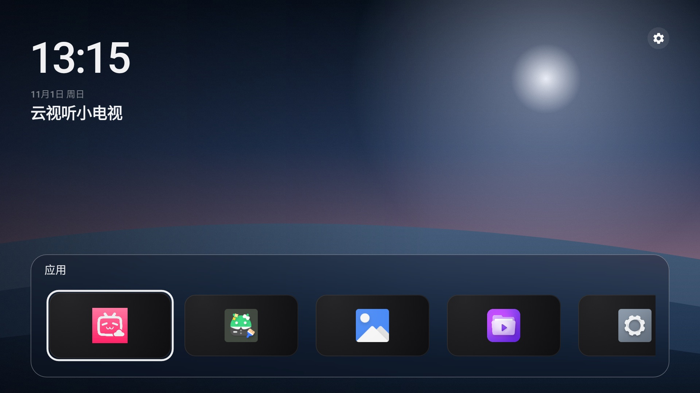

<h1>Slate</h1>

给旧电视用的 Android 桌面。

  
  
  
  
  

国产电视自带的桌面里，广告、通知和会员入口太多。已有的开源桌面里有不少好作品，但在系统版本旧、内存小的电视上跑不顺。

Slate 是为此重写的 Android TV 桌面。时间、壁纸和一行应用，留在同一幅画面里。

## 桌面

左上是时间和日期，下面是当前焦点的应用名。应用排成一行，贴在底部。右上角打开电视自己的设置。

确定键打开应用。长按可以移动、查看信息或卸载。应用安装或卸载后，这一行会自己刷新。顺序和上次的焦点会被记住。

设置、应用信息和卸载都离开 Slate，打开系统自己的页面。

## 文档

- [开发](docs/development.md)：构建、模拟器、安装到电视
- [界面](docs/ui.md)：桌面结构、焦点和文案
- [参与开发](CONTRIBUTING.md)：分支、提交信息和代码约定
- [原型](prototype/index.html)：交互原型

## 许可证

[Apache-2.0](LICENSE)

设计方向参考了社区里的极简电视桌面，代码为本项目独立实现。
